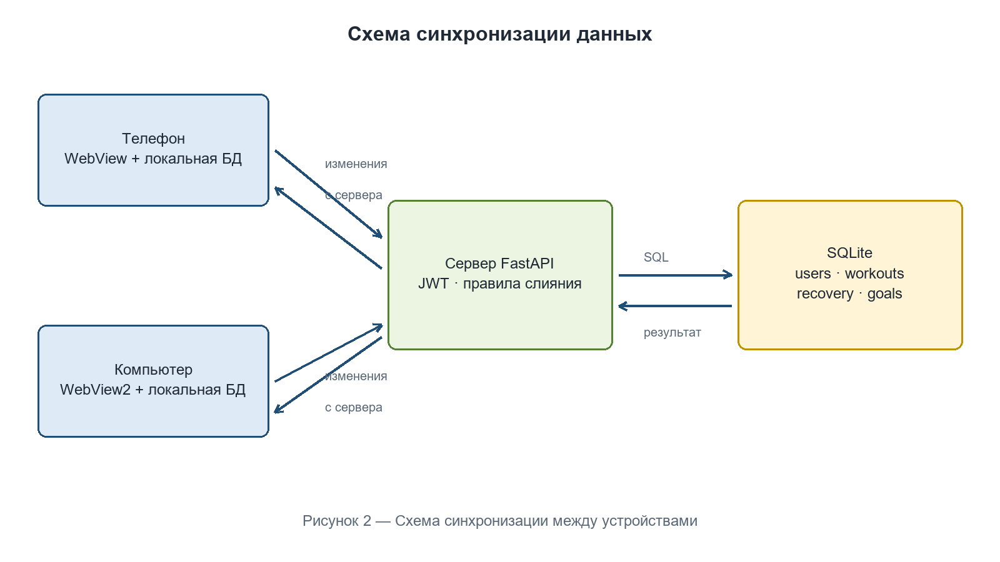

# Форма — трекер тренировок с синхронизацией

Приложение для учёта тренировок и восстановления с общим аккаунтом: веб-версия, оболочка Windows (EXE) и Android (APK). Данные хранятся локально и синхронизируются через собственный сервер. Вариант 2 курсового проекта по МДК 01.03.



## Состав

| Часть | Каталог | Что это |
|---|---|---|
| Веб-ядро | `src/` | общий интерфейс и логика (HTML/CSS/JS) |
| Сервер | `server/` | FastAPI + SQLite, JWT, обмен изменениями |
| Windows | `desktop/` | окно WebView2 + локальный сервер, сборка PyInstaller |
| Android | `android/` | WebView-оболочка, ассеты внутри APK |
| Сборка | `web/` | готовая версия с синхронизацией |

## Запуск сервера

```bash
cd server
python -m venv ../venv
../venv/Scripts/pip install -r requirements.txt
../venv/Scripts/python app.py
```

Сервер поднимается на `0.0.0.0:8000` и печатает адрес в локальной сети. Проверка: `http://127.0.0.1:8000/api/health`.

## Клиент

```bash
cd web
python -m http.server 8080
```

Открыть `http://localhost:8080`, в настройках указать адрес сервера, создать аккаунт. Второе устройство — тот же адрес и тот же аккаунт.

## Android

```bash
cd android
# открыть в Android Studio и собрать app, либо:
gradle assembleDebug
```

Веб-сборка уже лежит в `android/app/src/main/assets`. Для синхронизации по локальной сети сервер и телефон должны быть в одной сети, адрес — `http://<IP-ПК>:8000`.

## Windows

```bash
cd desktop
build.bat
```

Скрипт собирает `dist/Forma.exe` через PyInstaller. Требуется WebView2 (в Windows 10/11 уже установлен).

## Как устроена синхронизация

1. Клиент отправляет `since` — метку последней синхронизации — и все записи, изменённые после неё.
2. Сервер применяет изменения по правилу last-write-wins (`updated_at`).
3. Сервер возвращает записи, изменённые после той же метки, и своё время.
4. Клиент сохраняет ответ и обновляет метку.

Удаление передаётся как запись с `deleted = 1`, поэтому корректно применяется на всех устройствах. Пароли — PBKDF2-HMAC-SHA256 (210 000 итераций, соль), токен — HMAC-SHA256, срок 30 дней.

## API

| Метод | Путь | Назначение |
|---|---|---|
| GET | `/api/health` | проверка сервера |
| POST | `/api/auth/register` | регистрация |
| POST | `/api/auth/login` | вход |
| GET | `/api/me` | профиль по токену |
| POST | `/api/sync` | обмен изменениями |

## Документы

- `docs/Курсовая_APK_EXE_Кулаков.docx` — пояснительная записка, 25 листов;
- `docs/Презентация_APK_EXE_Кулаков.pptx` — 12 слайдов;
- `docs/screens/` — экранные формы.

## Статус сборок

Исходники оболочек готовы и лежат в репозитории. Готовые бинарники не приложены: APK собирается в Android Studio (нужен SDK), EXE — скриптом `desktop/build.bat` (PyInstaller). Это сделано намеренно: бинарники не хранятся в git.

## Автор

Кулаков Олег Николаевич, группа 42 ИСиП-П, ОГАПОУ «Белгородский индустриальный колледж», 2026.
